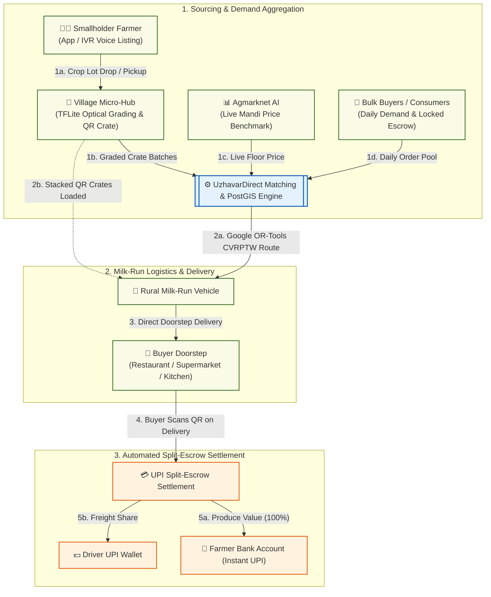

# Smart India Hackathon Workshop
# Date: 25/10/2026
## Reference Number: 26019545
## Name: Pukazh Gnana Vaendhar J

## Problem Title
SIH 26033: Multiple intermediaries reduce farmers earnings and increase consumer prices.

## Problem Creater's Organization
Ministry of Consumer Affairs, Food & Public Distribution

## Theme
Agriculture, FoodTech & Rural Development

## Problem Description
Expected Solution: Create a digital marketplace that:

• Connects farmers/FPOs directly with consumers and bulk buyers.
• Provides logistics support.
• Uses AI for demand forecasting and route optimization.

Benefits:

• Better prices for farmers.
• Lower prices for consumers.
• Reduced supply chain inefficiencies.

## Proposed Solution

### Detailed Explanation of the Proposed Solution
*UzhavarDirect (AgriCrate Grid)* is a decentralized, ONDC-integrated Cooperative Micro-Fulfillment and "Milk-Run" Logistics Platform designed for smallholder farmers and Farmer Producer Organizations (FPOs) cultivating perishable vegetables and fruits (such as tomatoes, onions, and bananas).

Instead of relying on village aggregators, mandi commission agents, and wholesale sub-brokers, the platform sets up *Village Micro-Hubs* equipped with QR-tagged smart crates and an *Automated Demand-Pooling Engine*. Bulk buyers (hostels, supermarkets, restaurants, apartment associations) and retail consumer groups post daily demand online. Nearby farmers lock in guaranteed floor-price slots directly from their mobile phones or via a vernacular voice call before harvesting begins.

### How It Addresses the Problem
* *Eliminates Middleman Markups:* Replaces 4–5 intermediary layers with a direct Farm-to-Micro-Hub-to-Buyer chain, reducing supply chain commission markups from 45–60% down to a transparent 4% network fee.
* *Pre-Harvest Demand Locking:* Prevents distress selling at mandis by matching ready-to-harvest crops with verified buyer orders 24–48 hours before harvest.
* *Milk-Run Shared Transport:* Uses scheduled multi-stop rural collection routes ("milk runs") so small farmers with even 50–100 kg of produce can ship at bulk full-truckload rates.
* *Instant Split-Escrow UPI Payouts:* Splits buyer payments automatically upon smart-crate QR scan—sending the transport share to the driver and 100% of the produce value directly to the farmer's bank account via UPI.

### Innovation and Uniqueness of the Solution
* *Smart-Crate Zero-Repackaging Chain:* Produce is weighed and graded once at the farm gate into stackable, QR-coded returnable plastic crates (RPCs), eliminating repeated unloading, bruising, and manual re-weighing deductions.
* *Perishability-Aware Dynamic Routing:* Prioritizes vehicle dispatch and buyer matching based on transit distance and remaining crop shelf-life to prevent post-harvest spoilage.
* *Feature-Phone IVR Voice Access:* Farmers without smartphones can accept buyer bids and book crate pickup slots via a regional-language voice call and SMS confirmation.

## Technical Approach
### Technologies to Be Used
* *Web & Mobile Frontend:* React.js / Next.js dashboard for bulk buyers and FPO admins; Flutter cross-platform mobile app with offline SQLite storage for farmers and collection drivers.
* *Voice & Feature-Phone Access:* Exotel IVR integrated with Bhashini APIs for regional language speech-to-text crop listing.
* *Backend & Open Network Layer:* Node.js (NestJS) and Python (FastAPI) microservices built on *Beckn Protocol (ONDC)* standards for open buyer-seller discovery.
* *AI & Optimization Modules:*
  * *Price & Demand Forecasting:* LightGBM model trained on historical Agmarknet mandi arrivals and seasonal weather data.
  * *Route Optimization:* Google OR-Tools (Capacitated Vehicle Routing Problem with Time Windows — CVRPTW) for multi-farm pickup routing.
  * *Mobile Optical Grading:* TensorFlow Lite (MobileNetV3) running offline on the hub coordinator's smartphone to grade crop size and surface quality.
* *Database & Mapping:* PostgreSQL with *PostGIS* for geospatial farm clustering; Redis for real-time order matching.

### Technical Architecture & Workflow Diagram

### Methodology and Process for Implementation
1. *Demand Clustering:* Bulk kitchens, retailers, and consumer apartment clusters post daily orders that are grouped geographically using PostGIS spatial indexing.
2. *Benchmark Floor-Price Broadcast:* The AI pricing service checks live Agmarknet mandi rates and broadcasts a guaranteed purchase price to registered farmers within a 100 km radius.
3. *Smart-Crate Loading & Edge Grading:* Farmers bring produce to the local FPO micro-hub (or book farm-gate pickup), where a smartphone camera verifies grade quality and logs the weight into a QR-coded crate.
4. *Optimized Milk-Run Dispatch:* Google OR-Tools generates a multi-stop pickup route for partnered rural mini-trucks, transporting crates directly from villages to urban buyer drop points.
5. *Instant Escrow Settlement:* Scanning the crate QR code at pickup and delivery automatically releases UPI escrow funds directly to the farmer's bank account.

## Feasibility and Viability
### Analysis of the Feasibility of the Idea
* *Technical Feasibility:* Built using reliable open-source tools (FastAPI, PostGIS, Google OR-Tools, TensorFlow Lite) and existing public digital infrastructure (UPI, Bhashini, Agmarknet).
* *Operational Viability:* Operates on an asset-light model by utilizing existing FPO sheds as village hubs and partnering with local rural commercial vehicles (such as Tata Ace / Mahindra Bolero) on a per-trip payout basis.
* *Financial Viability:* A flat 4% service and crate-pooling fee sustains platform operations while saving 25–35% compared to traditional multi-middleman chains.

### Potential Challenges and Risks
* *Quality Disputes at Delivery:* Buyers may claim the delivered produce does not match the expected grade.
* *Scattered Small Volumes:* Picking up very small quantities from isolated farms can increase fuel costs.
* *Digital Literacy Barriers:* Rural farmers may hesitate to use smartphone apps or wait for online payments.

### Strategies for Overcoming These Challenges
* *Timestamped QR Grade Lock:* Optical grading photos and digital scale weights are linked to the crate's QR code at pickup, protecting farmers from unfair buyer deductions later.
* *Cluster Minimum Thresholds:* PostGIS automatically schedules free farm-gate pickup when combined village lots cross 1 tonne, while smaller lots are dropped at the nearest 3 km Panchayat collection point.
* *Instant Pickup Advance + Voice Support:* Farmers can use regional-language phone calls to book slots and receive an instant 80% UPI advance the moment their crate is loaded onto the truck, with the remaining 20% paid on delivery.

## Impact and Benefits
### Potential Impact on the Target Audience
* *Farmers & FPOs:* Eliminates exploitative broker commissions, guarantees pre-harvest floor prices, and provides immediate digital bank payments.
* *Consumers & Bulk Buyers:* Receives fresher, farm-traceable produce 24–36 hours faster at lower retail prices.

### Benefits of the Solution
* *Economic Benefits:* Increases the farmer's share of the consumer rupee from ~33% to *70%+* while reducing consumer and bulk buyer prices by *15–20%*.
* *Social Benefits:* Strengthens local FPOs and creates rural employment for youth and women Self-Help Groups (SHGs) managing village crate hubs.
* *Environmental Benefits:* Reusable plastic crates replace single-use sacks, and optimized direct routing cuts post-harvest food wastage from 20%+ to under 5%.

## Research and References
* *Ministry of Consumer Affairs, Food & Public Distribution:* Price Monitoring Division data on wholesale-to-retail price spreads (https://consumeraffairs.nic.in/).
* *Ministry of Agriculture & Farmers Welfare — Agmarknet Portal:* Daily mandi arrival and wholesale price datasets (https://agmarknet.gov.in/).
* *Open Network for Digital Commerce (ONDC):* Beckn protocol specifications for decentralized agricultural marketplaces (https://ondc.org/).
* *Google OR-Tools — Vehicle Routing Problem with Time Windows (VRPTW):* Optimization models for multi-stop perishable logistics (https://developers.google.com/optimization/routing/vrptw).
* *Digital India Bhashini Mission:* Open APIs for Indian regional language voice recognition (https://bhashini.gov.in/).
